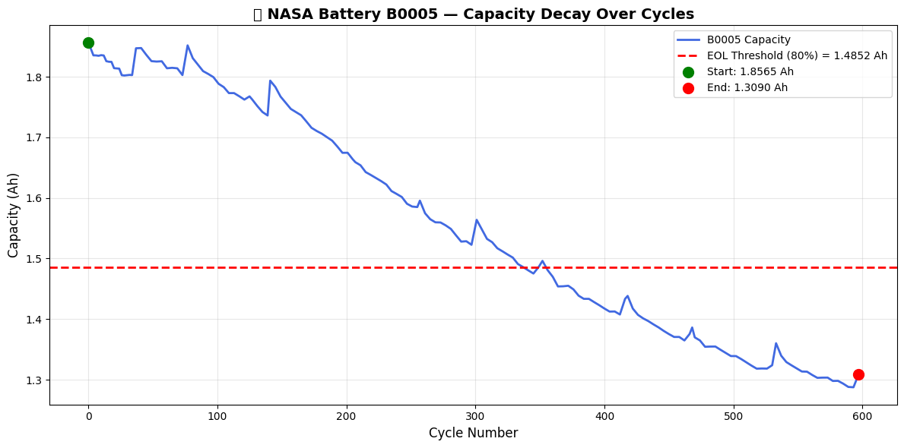
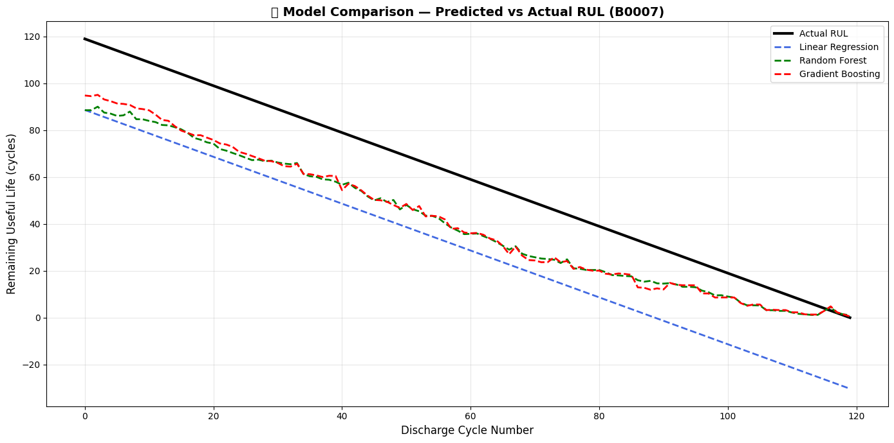
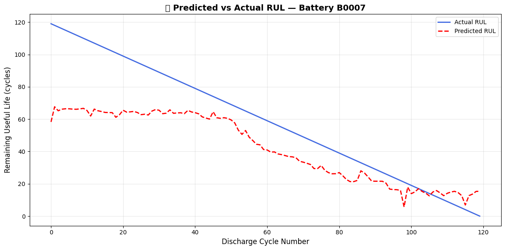
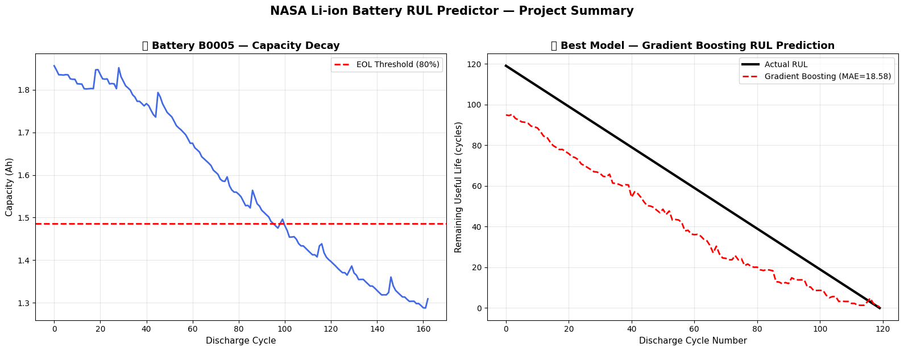
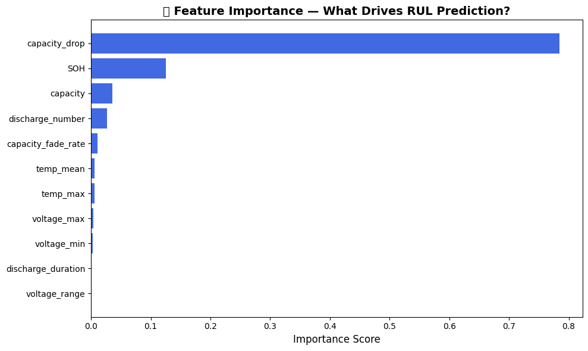

# 🔋 NASA Battery Degradation & Remaining Useful Life Predictor

[](https://python.org)
[](https://scikit-learn.org)
[](https://www.nasa.gov)

---

## 📌 Project Overview

This is an end-to-end machine learning project that uses real NASA lithium-ion battery telemetry data to predict the **Remaining Useful Life (RUL)** of a battery — meaning how many charge/discharge cycles it has left before it hits end-of-life.

The project goes from raw NASA `.mat` files all the way to a trained, evaluated ML model with professional visualizations — covering data loading, feature engineering, RUL calculation, model training, comparison and evaluation.

---

## 🌍 Real World Problem

Lithium-ion batteries power everything — **Electric Vehicles, aerospace satellites, grid energy storage.** Over hundreds of charge/discharge cycles, internal chemical degradation causes capacity to slowly drop.

**The Problem:**
- Replacing batteries too early = wasted money
- Replacing them too late = catastrophic failure and safety risk
- Unexpected failure = severe operational downtime

**The Solution:**
Build an AI model that monitors early-cycle battery telemetry and forecasts exactly how many cycles remain before the battery dies — so maintenance can be planned well in advance.

---

## 📊 Dataset

**Source:** NASA Ames Prognostics Center of Excellence (PCoE)  
**Link:** [NASA Battery Aging Dataset](https://www.nasa.gov/intelligent-systems-division/discovery-and-systems-health/pcoe/pcoe-data-set-repository/)

NASA ran real 18650 lithium-ion battery cells through hundreds of charge/discharge cycles in a lab until they died, recording every sensor reading along the way — voltage, current, temperature and capacity.

| Battery | Starting Capacity | EOL Threshold (80%) | Died at Cycle |
|---------|-------------------|----------------------|---------------|
| B0005   | 1.8565 Ah         | 1.4852 Ah            | 96            |
| B0006   | 2.0353 Ah         | 1.6283 Ah            | 58            |
| B0007   | 1.8911 Ah         | 1.5128 Ah            | 119           |

> **Interesting finding:** B0006 started with the highest capacity but died the earliest — real-world battery behavior is unpredictable, which is exactly why we need ML!

---

## 🔋 Battery Capacity Decay

This chart shows the full life of battery B0005 — from full health to end-of-life. The red dashed line is the EOL threshold (80% of starting capacity). Once the blue line crosses it, the battery is considered dead.



---

## 🧠 Methodology

### Step 1 — Data Loading
Loaded NASA `.mat` (MATLAB format) files using SciPy. Each file contains hundreds of charge, discharge and impedance cycles with full sensor readings per cycle.

### Step 2 — Feature Engineering
Instead of feeding raw time-series data into the model, extracted 11 meaningful features per discharge cycle:

| Feature | Description |
|---------|-------------|
| `capacity` | Total discharge capacity that cycle (Ah) |
| `voltage_min` | Minimum voltage during discharge |
| `voltage_max` | Maximum voltage during discharge |
| `voltage_range` | Difference between max and min voltage |
| `temp_max` | Peak temperature during discharge |
| `temp_mean` | Average temperature during discharge |
| `discharge_duration` | How long the discharge took |
| `discharge_number` | Which discharge cycle number this is |
| `capacity_drop` | How much capacity has been lost since cycle 1 |
| `capacity_fade_rate` | How fast capacity is declining (rolling avg over last 5 cycles) |
| `SOH` | State of Health — capacity as % of original |

### Step 3 — RUL Calculation
For each discharge cycle:
```
EOL = first cycle where capacity drops below 80% of initial capacity
RUL = EOL cycle number - current cycle number
```

### Step 4 — Cell-Level Holdout Validation
This is the most critical engineering decision in the project.

❌ **Wrong way:** Randomly split cycles into train/test — the model just memorizes each battery (data leakage)

✅ **Right way:** Train on B0005 + B0006, test on completely unseen battery B0007

This proves the model actually learned something generalizable, not just memorized the training batteries. This is the industry-standard approach for battery prognostics.

---

## 🤖 Models Trained & Compared

Three models were trained and compared on the same holdout battery (B0007):

| Model | MAE (cycles) | RMSE (cycles) |
|-------|-------------|----------------|
| Linear Regression | 30.34 | 30.34 |
| Random Forest | 19.16 | 20.44 |
| **Gradient Boosting ✅ Winner** | **18.58** | **19.71** |

**Gradient Boosting** won because it builds trees sequentially — each new tree learns from the mistakes of the previous one, making it smarter than Random Forest for this kind of degradation pattern.

**Linear Regression** performed worst and even predicted negative RUL values in later cycles — proving the relationship between features and RUL is non-linear and requires a more powerful model.

---

## 📈 Visualizations

### Model Comparison — All 3 Models vs Actual RUL


### Predicted vs Actual RUL — Best Model (Gradient Boosting)


### Project Summary


---

## 🔍 Feature Importance

Which features did the model find most useful for predicting RUL?



**Key insight:** `capacity_drop` (how much capacity has been lost since day 1) is by far the most important feature with a score of 0.78 — the model is essentially saying *"just tell me how much capacity has been lost and I can predict how much life is left."* This makes complete physical sense and is backed by real battery degradation science!

---

## 📉 Why Isn't the Model Perfect?

Honest answer — the model has a MAE of 18.58 cycles on B0007 which has 120 total cycles, meaning ~15% average error. Here is why:

- Only 3 batteries of training data — very small dataset
- B0006 died at cycle 58 but B0007 lived to cycle 119 — very different degradation behavior makes generalization hard
- Early-cycle predictions are harder (predicting far into the future is always harder than near-term)

The model correctly learns the **downward trend** and converges accurately in the final cycles, which matter most for real-world maintenance planning. This limitation is openly documented because honest evaluation is more valuable than inflated accuracy claims.

---

## 🛠️ Tech Stack

| Tool | Purpose |
|------|---------|
| Python 3.x | Core language |
| Pandas | Data manipulation and feature engineering |
| NumPy | Numerical computing |
| SciPy | Loading NASA .mat MATLAB files |
| Scikit-Learn | ML models (Random Forest, Gradient Boosting, Linear Regression) |
| Matplotlib | All visualizations and charts |
| Seaborn | Statistical styling |
| Google Colab | Cloud development environment |

---

## 🚀 How to Run

1. Clone this repository:
```bash
git clone https://github.com/rugvedchauragade/nasa-battery-rul-predictor.git
```

2. Install dependencies:
```bash
pip install -r requirements.txt
```

3. Open `NASA_Battery_RUL_Predictor.ipynb` in Google Colab or Jupyter Notebook

4. Run all cells from top to bottom

> **Note:** The NASA dataset is downloaded automatically inside the notebook via the MathWorks mirror. No manual download needed.

---

## 📁 Repository Structure

```
nasa-battery-rul-predictor/
├── NASA_Battery_RUL_Predictor.ipynb           # Main project notebook
├── requirements.txt                            # Python dependencies
├── README.md                                   # This file
├── Capacity_Decay_over_Cycles.png              # Battery B0005 decay visualization
├── Model_Comparison.png                        # All 3 models vs actual RUL
├── Predicted_vs_Actual_RUL_-_Battery_B0007.png # Best model predictions
├── Project_Summary.png                         # Two-chart project summary
└── What_Drives_RUL_Prediction.png              # Feature importance chart
```

---

## 🎯 Key Learnings

1. **Cell-level holdout validation** is essential for battery ML — random splits cause data leakage
2. **Capacity drop from initial value** is the single most predictive feature (importance: 0.78)
3. **Non-linear models** (Gradient Boosting, Random Forest) significantly outperform Linear Regression for degradation prediction
4. **More training batteries** would be the single biggest improvement to model accuracy
5. **Early-cycle RUL prediction** is fundamentally harder than late-cycle — a known challenge in prognostics research

---

## 📚 References

- NASA Ames Prognostics Center of Excellence Battery Dataset
- B. Saha and K. Goebel (2007). "Battery Data Set", NASA Ames Prognostics Data Repository, NASA Ames Research Center, Moffett Field, CA

---

## 👤 Author

**Rugved Chauragde**
- GitHub: [@rugvedchauragde](https://github.com/rugvedchauragade)
